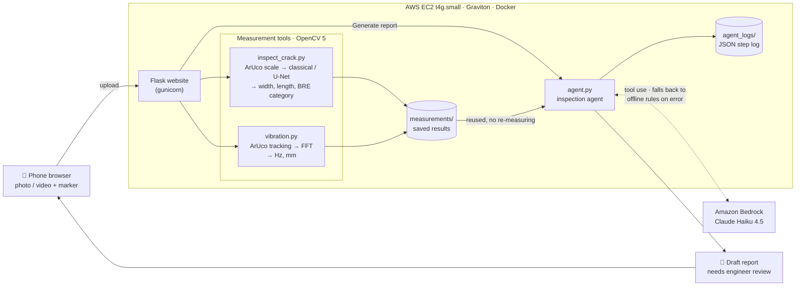

# CrackPulse

Measure crack width in millimetres and structural vibration in hertz with a phone camera and a printed marker.

**Live demo:** http://3.106.138.213. It runs on AWS EC2 t4g.small (Graviton, Arm64) in Docker, in the Sydney region.

## Problem

Checking cracks and vibration in bridges and buildings is expensive and mostly manual. An inspector measures
crack widths by hand with a crack-width gauge or ruler, and vibration needs accelerometers and data loggers.
Small sites and regular follow-up checks often don't get measured at all, so nobody notices when a crack
grows or a structure's behaviour changes.

CrackPulse turns a phone photo or video into measurements in real units. The only extra item is a printed
ArUco marker of known size.

## What it does

| Feature | How |
|---|---|
| **Crack width, length and damage category** | Photo with the printed marker → the marker gives the mm scale and corrects the camera angle (perspective rectification to 10 px/mm). The crack is found with a **classical** method (black-hat filter + Otsu threshold) or a trained **U-Net** (MobileNetV2 encoder, ONNX, run on CPU with OpenCV 5 DNN). Width is measured at every skeleton point from the brightness profile across the crack (sub-pixel FWHM). Output: median and 95th-percentile width, length, and the **BRE Digest 251** damage category. |
| **Vibration from video** | The marker is tracked in every frame (ArUco, sub-pixel corners). Its movement is converted to mm and an **FFT** gives the dominant frequency (Hz) and amplitude (mm). |
| **Inspection agent** | Runs the right measurement tool for each uploaded file and writes a **draft** inspection report that a human must review (details [below](#inspection-agent)). |

## Architecture



## Results

All numbers below come from files in this repo ([metrics.json](metrics.json),
[results/accuracy.md](results/accuracy.md), [TODO.md](TODO.md)), or from running the scripts.

### Crack detection: U-Net vs classical

DeepCrack test set (237 images), pixel-level ([metrics.json](metrics.json)):

| Method | Precision | Recall | F1 | IoU |
|---|---|---|---|---|
| Classical (black-hat + Otsu) | 0.216 | 0.736 | 0.334 | 0.201 |
| **U-Net (MobileNetV2)** | **0.906** | **0.811** | **0.856** | **0.748** |

The classical method finds most cracks but also marks many non-crack pixels. The U-Net is much more precise.

### Width accuracy on a real printed calibration sheet

[calibration_sheet.pdf](calibration_sheet.pdf) has a 50 mm marker and test lines of 0.3, 0.5, 1.0 and
2.0 mm. It was printed, put on a wall and photographed. Classical method, 50 mm marker.

**Only one full-resolution real photo has been tested so far** (phone camera, 4080 × 3060, 12.3 px/mm):

| Line | True | Measured | Error |
|---|---|---|---|
| 1 | 0.30 mm | 0.25 mm | −17% |
| 2 | 0.50 mm | 0.44 mm | −12% |
| 3 | 1.00 mm | 0.95 mm | −5% |
| 4 | 2.00 mm | 1.96 mm | −2% |

All four lines read about 0.05 mm (half a pixel) under the nominal width. The printed lines may be slightly
thinner than nominal, but the printed width was not checked with a physical gauge.

On synthetic photos made from the same PDF (rotation, tilt, blur, noise, shadow, JPEG), where the true width
is known exactly, the 1.0 and 2.0 mm lines read within +4%. The 0.3 mm line reads too wide (+12% to +92%)
as the photo resolution drops. See [results/accuracy.md](results/accuracy.md).

### Effect of compressed (WhatsApp) photos

Two more photos of the sheet were sent through WhatsApp, which shrank them to 1280 × 960 (about 2.4 px/mm):

| Photo | 0.3 mm | 0.5 mm | 1.0 mm | 2.0 mm |
|---|---|---|---|---|
| WhatsApp photo 1 | failed: only 3 of 4 lines found | | | |
| WhatsApp photo 2 | 0.61 (+102%) | 0.71 (+42%) | 0.79 (−21%) | 1.69 (−16%) |

Averaged over the two photos that gave a result (full-res + WhatsApp 2), the average absolute error is 59%,
27%, 13% and 9% for the four lines. At 2.4 px/mm a 0.3 mm line is less than one pixel wide, and compression
blurs the edges. **Use full-resolution photos.** In WhatsApp, send the photo as a *document*.

### Vibration (synthetic test)

[make_test_video.py](make_test_video.py) makes a 10 s, 30 fps video of a 50 mm marker moving up and down
with a known motion. Result from [vibration.py](vibration.py):

| | Frequency | Amplitude |
|---|---|---|
| Ground truth | 3.0 Hz | 2.0 mm |
| Measured | 3.0 Hz | 2.026 mm (+1.3%) |

The marker was found in 300 of 300 frames. This is a synthetic video. The module has not yet been checked
against a real structure with a reference sensor.

### Analysis time

Full crack analysis of one 2400 × 1600 photo with the U-Net, on a laptop CPU: **19.6 / 24.5 / 18.5 s**
(3 runs, about 20 s). Most of this is model inference: 70 tiles of 384 × 384, 13.0 to 18.6 s. Everything
else (start-up, marker, rectification, measurement, saving images) takes about 2 s. **Timing on the EC2
t4g.small: pending** (not measured yet). Ideas for speeding it up are listed in [TODO.md](TODO.md).

## Inspection agent

[agent.py](agent.py) uses the Amazon Bedrock **Converse API with tool use**.

- **Tools:** `inspect_crack` (photo → width, length, BRE category) and `measure_vibration` (video → Hz, mm).
  These are the same scripts the website uses. The agent can only open files that the user uploaded.
- **No re-measuring:** if the website already measured the file with the same marker size and method, the
  agent reuses that saved result. The step list on the website shows "Reused earlier measurement".
- **Guard rails:** at most 6 tool calls and 8 model turns. Temperature 0. The prompt forbids making up
  numbers and forbids any "safe / unsafe" verdict.
- **Number check:** after the report is written, every value in mm or Hz is compared with the tool outputs.
  Any value that doesn't match is listed at the end of the report as "must be verified".
- **Retries and failures:** Bedrock calls retry up to 3 times. If a tool fails (for example, marker not
  found), the report explains how to retake the photo or video. On the command line, the agent can also ask
  the user once for a new file. If Bedrock fails for any reason, the agent switches to an **offline
  rule-based report** built from the same tool results.
- **Logs:** every run saves a JSON log in `agent_logs/` with each step, tool input and output, time per
  step, tokens and the final report. The website shows these steps under "How the agent worked".
- **Human review:** every report starts with the line "DRAFT - needs review by a qualified engineer". The
  website shows it as a badge, plus a "Generated offline (rule-based)" badge when the fallback was used.

> **Honest status:** the Bedrock integration (Claude Haiku 4.5, `ap-southeast-2`) is built, but the new
> AWS account's Bedrock token quota is 0. Every call returns `ThrottlingException: Too many tokens per day`.
> **The demo therefore runs the offline rule-based fallback.** A report written by the model has not been
> tested end to end yet ([TODO.md](TODO.md), item 3).

## Limitations

- **The marker is required.** Without the printed ArUco marker in the photo or video, there is no mm scale
  and no measurement. It must be printed at 100% scale and be fully visible.
- **The U-Net does not detect printed lines.** It treats sharp ink lines as non-cracks, so the calibration
  sheet can only test the classical method.
- **Tile joints and other straight dark lines** (grout lines, edges, shadows) can be marked as cracks. Check
  the overlay image before trusting a number.
- **Thin cracks need resolution.** A line thinner than the blur in the photo reads too wide. For hairline
  cracks, take the photo closer and don't use compressed images.
- **Limited validation:** width accuracy was tested on only one full-resolution real photo, and vibration
  only on a synthetic video.
- **The final safety decision belongs to a qualified engineer.** CrackPulse gives measurements and a draft
  note, not a structural assessment.

## How to run

### On a laptop

Python 3.12 is recommended (the versions in `requirements.txt` are pinned for it).

```bash
pip install -r requirements.txt
python app.py                       # http://localhost:5000 (phones on the same Wi-Fi can open it too)
```

Command-line tools:

```bash
python make_calibration_sheet.py                          # calibration_sheet.pdf, print at 100% scale
python inspect_crack.py photo.jpg 50 --method dl          # or --method classical
python vibration.py video.mp4 50
python measure_test_lines.py photo_of_sheet.jpg 50        # accuracy check on the printed sheet
python agent.py --photo photo.jpg --video video.mp4 --marker-mm 50 --offline
```

### With Docker (laptop or EC2)

```bash
docker build -t crackpulse .
docker run -d --restart unless-stopped -p 8000:8000 crackpulse     # http://localhost:8000
```

### On EC2 (Graviton / Arm64)

These are the steps used for the live demo:

| | |
|---|---|
| Instance | t4g.small (Graviton, Arm64), Amazon Linux 2023, 20 GB gp3 |
| Region | Sydney (`ap-southeast-2`) |
| Security group | HTTP (80) and SSH open |
| Login | EC2 Instance Connect from the browser |

```bash
# Docker and git
sudo dnf install -y docker git && sudo systemctl enable --now docker

# 2 GB swap
sudo fallocate -l 2G /swapfile && sudo chmod 600 /swapfile && sudo mkswap /swapfile && sudo swapon /swapfile

# Build on the instance, so the image is native arm64 (took about 2 minutes)
git clone https://github.com/krittikanandy06-ctrl/crackpulse.git && cd crackpulse && sudo docker build -t crackpulse .

# Serve on port 80
sudo docker run -d --name crackpulse -p 80:8000 --restart unless-stopped crackpulse

# Check
curl http://localhost/health        # -> ok
```

The site is live at http://3.106.138.213. All dependencies have ready-made arm64 wheels, so nothing is
compiled from source during the build.

To build for both architectures from a laptop, run
`docker buildx build --platform linux/amd64,linux/arm64 -t crackpulse .`.

To use Bedrock, give the instance an IAM role with Bedrock access, or pass the key when the container starts
(`-e AWS_BEARER_TOKEN_BEDROCK=...`). Secrets are never copied into the image. Optional settings:
`BEDROCK_MODEL_ID`, `MAX_UPLOAD_MB` (default 100), `KEEP_FILES_HOURS` (default 24), `WEB_CONCURRENCY`,
`GUNICORN_THREADS`. Health check: `GET /health`.

## Responsible use

- CrackPulse is a **measurement aid, not a safety verdict**. Every report is marked as a draft and
  recommends review by a qualified structural engineer. The agent is told never to call a structure safe or
  unsafe.
- Reports may only use numbers from the measurement tools, and any value that doesn't match is flagged for
  checking.
- The accuracy results above include the weak cases (thin lines, compressed photos, the U-Net on printed
  lines), so users know where not to rely on the tool.
- Uploaded photos and videos, results and agent logs are deleted automatically after 24 hours (adjustable).
  Uploads are not publicly reachable, and only photo/video file types are accepted.
- The container runs as a non-root user, and API keys are supplied only at runtime.

Built with help from Claude (Anthropic) as a coding assistant.
